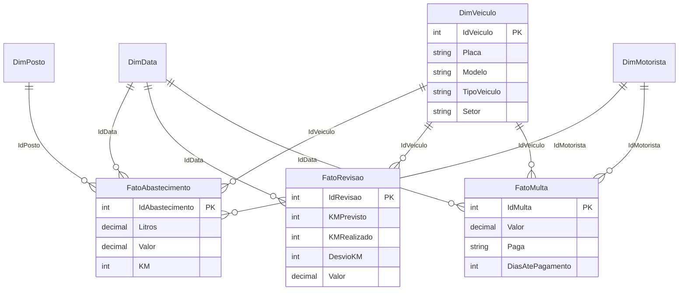

# 🚚 Star Schema de Frota e Logística

Do Excel operacional bagunçado a um modelo dimensional pronto para o Power BI, com log de qualidade e integridade referencial conferida a cada execução.

> ⚠️ **Dados fictícios.** Veículos, placas, motoristas e valores são gerados por script. O desenho do modelo é o que uso em painéis reais de gestão de frota.

## 🎯 Problema de negócio

O controle de frota costuma viver em planilhas separadas: abastecimento em uma, revisões em outra (uma coluna para cada marco de quilometragem), multas em uma terceira. Responder "quanto custa cada veículo por quilômetro?" exige juntar tudo à mão.

Este projeto consolida as fontes em um único modelo analítico para responder:

- Qual é o custo por veículo, por setor e por quilômetro rodado?
- Quais veículos estão atrasando revisões preventivas?
- Quanto há em multas em aberto, e quem são os condutores recorrentes?

## 🏗️ Modelo dimensional



Detalhes de cada coluna em [docs/dicionario_de_dados.md](docs/dicionario_de_dados.md).

## 🧹 Problemas de dados tratados

| Problema na origem | Tratamento |
|---|---|
| Revisões em formato "largo" (3 colunas por marco de KM) | *Unpivot* para uma linha por revisão, com `DesvioKM` calculado |
| Datas com ano digitado errado (`05/09/0026`) | Anuladas e registradas no log; a linha é mantida |
| Valores em texto no padrão brasileiro (`1.234,56`) | Convertidos para número |
| Placas com espaços e minúsculas | Normalizadas antes do relacionamento |
| "Multa Paga" contém a **data** do pagamento, e não sim/não | Vira `DataPagamento`, `Paga` e `DiasAtePagamento` |
| Tipo de veículo ausente na origem | Derivado do modelo por palavra-chave |
| Multas de placas sem cadastro | Removidas da fato e listadas em `registros_orfaos.csv` |

## ▶️ Como executar

```bash
pip install -r requirements.txt
python scripts/gerar_dados_brutos.py     # cria dados_brutos/
python src/etl_frota.py                  # cria saida/
```

O ETL é um script único e reexecutável: cada execução reconstrói o modelo inteiro a partir das fontes brutas.

## 📊 Resultado da demonstração

| Tabela | Linhas |
|---|---:|
| DimData | 730 |
| DimVeiculo | 40 |
| DimMotorista | 12 |
| DimPosto | 5 |
| FatoAbastecimento | 3.000 |
| FatoRevisao | 90 |
| FatoMulta | 81 |

- **Integridade referencial conferida** em todas as fatos (a execução falha se houver chave sem correspondência).
- **175 registros** com apontamento de qualidade: 155 placas normalizadas, 11 datas implausíveis anuladas e 9 multas órfãs.

## 📐 Medidas DAX

O arquivo [dax/medidas.dax](dax/medidas.dax) traz as medidas do painel: custo total, custo por quilômetro, consumo médio, aderência às revisões e multas em aberto.

## 📁 Estrutura

```text
├── scripts/gerar_dados_brutos.py   # gera as planilhas brutas fictícias
├── src/etl_frota.py                # ETL completo
├── dados_brutos/                   # entradas de exemplo
├── saida/                          # Dimensoes/, Fatos/, Qualidade/
├── docs/dicionario_de_dados.md
└── dax/medidas.dax
```

## 🛠️ Tecnologias

Python · pandas · modelagem dimensional (Star Schema) · Power BI · DAX

## 👤 Autor

**Newton Giovanni** · Economista e Analista de Dados Estratégicos · [LinkedIn](https://www.linkedin.com/in/newton-giovanni/)
